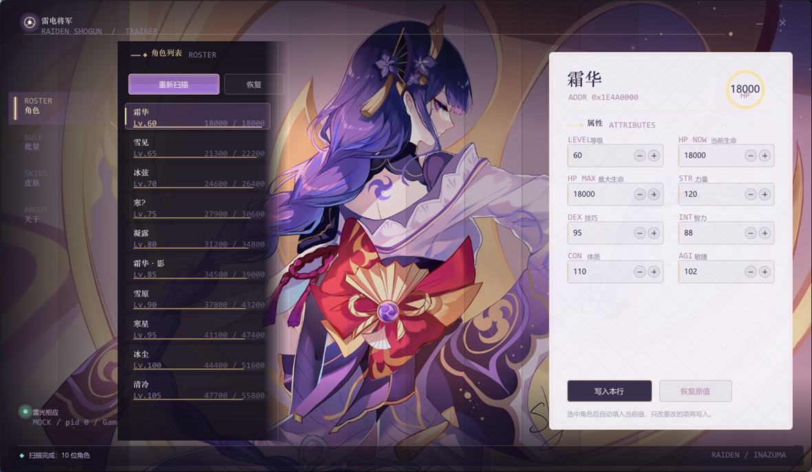

# Raiden UI

雷电将军（雷电影）主题的 Windows 桌面 UI，用 **C++17 + Win32 + Direct3D 11 + Dear ImGui** 全自绘。

灵感与版式参考 [HanaBi-ui-Genshin](https://github.com/xiaoyeuzixi/HanaBi-ui-Genshin)（甘雨主题），这套是独立实现的稻妻和风版本。



## 特点

| | |
|---|---|
| **全自绘** | 不使用 ImGui 默认深色皮肤，所有控件手工绘制 |
| **立绘背景** | 整张立绘铺底，人物区间保持原亮度，UI 只压两侧暗部 |
| **宣纸面板** | 右侧浅色面板与左侧深紫形成「浓淡」对比，配金色描边与菱纹 |
| **无边框窗口** | 自绘标题栏、边缘缩放、DWM 原生圆角，无系统边框 |
| **零依赖** | 除 ImGui 与 stb_image 外不依赖任何第三方库 |

## 视觉细节

- **配色**取自参考立绘：深紫 `#100C18`、雷电紫 `#9870BA`、金 `#F0D8A8`、宣纸 `#F5F2F9`
- **金色新月弧** 呼吸动画，圆心在画面外，弧只落在暗部不压人物
- **三勾玉雷印记** 左上角缓速旋转
- **菱纹** 铺在宣纸与暗底，稻妻常见纹样
- **雷光微粒** 46 颗从右上光晕飘散
- **开场扫光** 金色弧线 1.35 秒横穿

## 构建

环境要求：Windows 10/11 x64、支持 D3D11 的显卡、**Visual Studio 2022**（MSVC v143）+ Windows SDK 10.0。

```bat
build.bat
```

产物 `bin\RaidenTrainer.exe`。脚本会自动定位 `vcvars64.bat`，支持 Community / Professional / Enterprise / BuildTools 四种安装。

```bat
build.bat clean     :: 清理中间产物
```

> 把 `raiden_bg.jpg` 和 `raiden_bg_small.jpg` 复制到 exe 同目录即可显示背景；
> 找不到时会退化为纯色渐变，界面仍可正常使用。

## 源码结构

```
raiden_main.cpp        全部界面实现（单文件，约 1500 行）
  ├─ 色板与文案        RaidenSkin R / namespace Txt
  ├─ 字体              BuildCnRanges + LoadFonts
  ├─ 控件               GoldButton / PaperButton / Section / NumInput / Toggle
  ├─ 页面              PageRoster / PageBulk / PageSkins / PageAbout
  └─ 渲染              D3D11 + ImGui 主循环

hw_bridge.h            UI 与数据层唯一接口（9 个函数）
hw_bridge_mock.cpp     假数据实现，用于独立跑界面
trainer.rc             图标与版本资源
app.ico                多尺寸图标（16/24/32/48/64/128/256）
stb_image.h            图片解码（JPEG 背景）
third_party/imgui/     Dear ImGui v1.91.5（含 Win32/DX11 后端）
```

## 接你自己的数据

UI 通过 `hw_bridge.h` 拿数据，**完全不碰内存**。实现这 9 个函数即可接入任意数据源：

```c
int            HW_AttachAndScan(void);   // 初始化 + 扫描
int            HW_Ready(void);           // 是否已连上
const char*    HW_LastError(void);       // 失败原因
const char*    HW_StatusLine(void);      // 状态栏小字
int            HW_Count(void);           // 条目数
const HeroRow* HW_HeroAt(int i);         // 取第 i 条
int            HW_SkinCount(int row);    // 子项数
int            HW_SkinIdAt(int row, int i);
const wchar_t* HW_SkinName(int skinId);
int            HW_WriteRow(int row, const int fields[8]);
int            HW_ApplyAll(int value);
int            HW_WriteSkin(int row, int skinId);
int            HW_RestoreOne(int row);
int            HW_RestoreAll(void);
void           HW_SetStatusSink(HW_StatusFn fn);
const char*    WideToUtf8(const wchar_t* w, char* out, int cap);
```

把 `build.bat` 里的 `hw_bridge_mock.cpp` 换成你的实现文件即可。

## 踩过的坑（都写在代码注释里了）

### 1. 源文件必须带 BOM 且加 `/utf-8`

两个条件缺一不可：

- **不带 BOM**：`cl.exe` 按系统代码页（CP936）读，中文注释的字节被当成语法，第 1 行就报错
- **只加 `/utf-8` 但不带 BOM**：窄字符串会被编译成 GBK，而 ImGui 按 UTF-8 解析，中文全变 `?`

### 2. `GetGlyphRangesChineseSimplifiedCommon()` 只有 2500 字

「寂」「鸣」「菱」「藕」这类字不在表内，会渲染成 `?`。

本项目的做法是把所有文案集中在 `namespace Txt`，构建字形范围时整段扫进图集：

```cpp
ImFontGlyphRangesBuilder b;
b.AddRanges(io.Fonts->GetGlyphRangesChineseSimplifiedCommon());
b.AddText(all_ui_text);   // 文案里每个字都进图集
b.BuildRanges(&g_cnRanges);
```

**不要直接加全 CJK 区 `0x4E00-0x9FFF`**：图集暴涨到 2 万字会导致 `imgui_impl_dx11.cpp` 建纹理失败，程序在 `pTexture != nullptr` 处断言崩溃，内存从 296 MB 飙到 813 MB。

### 3. `WS_THICKFRAME` 会产生一条 7px 白带

`WS_POPUP | WS_THICKFRAME` 组合下 Windows 会给无边框窗口画「可调整大小边框」，顶部出现整条 1324px 宽的白带。边缘缩放本来就在 `WM_NCHITTEST` 里自己实现，这个标志是多余的。

去掉后 `outer == client == 1340×780`，白带消失。

### 4. 不要用 `DwmExtendFrameIntoClientArea` + `DWMWCP_ROUND`

DWM 会在客户区外描一圈系统边框色，而 ImGui 只画到客户区内，四角露白。

正确做法是只开 DWM 原生圆角，并显式把边框色设为 NONE：

```cpp
DWM_WINDOW_CORNER_PREFERENCE cp = DWMWCP_ROUND;
DwmSetWindowAttribute(hwnd, DWMWA_WINDOW_CORNER_PREFERENCE, &cp, sizeof(cp));

DWORD none = 0xFFFFFFFE;  // DWMWA_COLOR_NONE
DwmSetWindowAttribute(hwnd, 34 /*DWMWA_BORDER_COLOR*/,  &none, sizeof(none));
DwmSetWindowAttribute(hwnd, 35 /*DWMWA_CAPTION_COLOR*/, &none, sizeof(none));
```

也不要用 `SetWindowRgn` 裁圆角——圆角外会透出桌面，换壁纸后又像白边。

### 5. `WS_POPUP` 不继承窗口类图标

`wc.hIcon` 设了也不生效，任务栏显示空白方块。必须显式 `WM_SETICON` 两档：

```cpp
SendMessageW(hwnd, WM_SETICON, ICON_BIG,   (LPARAM)hBig);
SendMessageW(hwnd, WM_SETICON, ICON_SMALL, (LPARAM)hSml);
```

### 6. `CalcTextSize` 要在正确字体下调用

`Section()` 里如果先 `PopFont` 再量中文宽度，拿到的是默认字体的宽度，英文标签会直接压在中文上。必须先 `PushFont(衬线体)` 再量。

## 字体

| 用途 | 字体 |
|---|---|
| 正文 | 微软雅黑 `msyh.ttc` |
| 标题 / 角色名 | 华文中宋 `STZHONGS.TTF`（回退宋体） |
| 数值 / 版本号 | Consolas `consola.ttf` |

全部是 Windows 系统自带，无需额外安装。

## 许可

代码 MIT。`third_party/imgui` 为 Dear ImGui（MIT），`stb_image.h` 为 public domain / MIT。

立绘素材版权归原作者所有，本仓库仅作界面演示用途，请勿商用。
